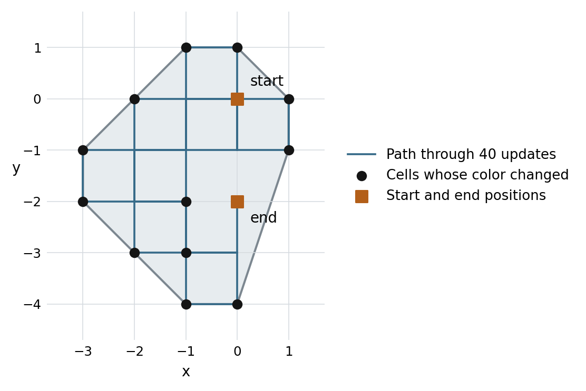

# Current result

The general finite-seed highway conjecture remains unproved. This continuation establishes several restricted results and reconstructs missing evidence for a public research claim. It does not provide a counterexample. The main gap is still the control of black cells that the ant writes, leaves behind, and later reads again.

The strongest analytic result here is an exact relation between a finite path and its endpoint fields. The cells whose colors differ at the endpoints, together with the two head positions, determine the convex hull of the entire path. The clock calculation also gives a cost for reducing an old highway wake: every later complete state must retain enough black cells, enough width, or both. Neither result requires the ant to stay inside the original strip.

The computer-assisted results have exact checks for all future steps. The rebuilt one-bit certificate covers every age of one specified canonical highway. A second certificate covers an explicit family of sixteen black cells at four square corners, for every positive integer scale. These families are strictly smaller than the set of all finite seeds.

The accompanying archive contains the proofs, source code, complete case records, independent checks, and open obligations. Claims called analytic below have written proofs. Claims called computer-assisted use exhaustive finite checks plus an argument that covers the unbounded parameters. Bounded searches are kept separate. No claim of publication priority or external review is made.

# Model and target

A state is $X_t=(B_t,p_t,h_t)$. The set $B_t$ contains every black cell, including old cells far from the ant. The head position is $p_t\in\mathbb Z^2$. North is $(0,1)$ and east is $(1,0)$. The heading codes are $N,E,S,W=0,1,2,3$.

At each update, a white cell makes the ant turn right and a black cell makes it turn left. The ant then flips the cell and moves one unit. The state at time $t$ is the state before update $t$.

The target is that every finite initial black set, with any initial pose, eventually follows the standard 104-turn highway. Translation, quarter rotation, and cyclic phase are allowed. A repeating turn word with some other period would not settle this target.

Let $W$ be the standard 104-letter turn word and let $F_{10}$ be its 84 cyclic factors of length ten. A forbidden event occurs when the true ten-turn window is outside $F_{10}$. The source attraction theorem says that, for finite fields, only finitely many such events imply eventual standard motion [2]. Near an input time, the true window uses the actual inverse orbit. It must not be filled with an assumed past.

# The endpoint fields determine the path hull

For a finite interval $s<t$, define

$$
P_{s,t}=\{p_s,p_{s+1},\ldots,p_t\},\qquad
\Delta_{s,t}=B_s\mathbin{\triangle}B_t.
$$

Here $\triangle$ is symmetric difference: a cell belongs to $\Delta_{s,t}$ exactly when its color differs between the endpoints. Write $\operatorname{conv}(S)$ for the smallest convex set containing $S$.

**Theorem 1.** For every actual finite orbit segment,

$$
\operatorname{conv}(P_{s,t})=
\operatorname{conv}\bigl(\Delta_{s,t}\cup\{p_s,p_t\}\bigr).
$$

**Proof.** The changed cells are precisely the cells read an odd number of times. They lie on the path. It is enough to show that every extreme vertex of the path hull, other than the two endpoint positions, is a changed cell.

Let $v$ be such a vertex. Two opposite grid neighbors of $v$ cannot both lie on the path: then $v$ would lie between them and would not be extreme. At most two neighbors can occur. Since $v$ is not an endpoint, a visit has both a predecessor and a successor. These neighbors are perpendicular.

Both the square parity and the heading axis change on every update. Thus every visit to a fixed cell has the same incoming axis. At $v$, one neighbor is the only possible predecessor and the other is the only possible successor. Every visit would require the same turn. But successive visits to a cell require opposite turns because the color flips. Therefore $v$ is visited exactly once. It belongs to $\Delta_{s,t}$. This proves the equality, including degenerate hulls.

{width=5.5in}

This extends the corner argument used in Etse's no-repeated-coloring result [1]. It is not presented as an independently established priority claim.

A useful consequence is

$$
\operatorname{conv}\bigl(B_0\cup B_t\cup\{p_0,p_t\}\bigr)
=
\operatorname{conv}\bigl(B_0\cup\{p_0,\ldots,p_t\}\bigr).
$$

The hull on the left grows monotonically. If both endpoint positions and every changed cell lie in a strip, the whole intervening path lies in that strip. An excursion outside the strip cannot disappear from the endpoint information unless an endpoint or a changed cell still records its outer extent.

The result does not bound the hull's size or its number of black cells. A few distant points can contain a large earlier hull. This is the exact limitation that prevents a direct proof of eventual highway motion.

# A cost for reducing an old wake

The handoff's clock proposal assumed a fixed strip. The following form applies to every later complete state, even after the ant has left that strip.

Put $\chi(q)=(-1)^{q_x+q_y}$. The quantity $\sigma$ equals $\chi(p)$ for a vertical heading and $-\chi(p)$ for a horizontal heading. It is invariant under the update. First choose $z=x+y$ and put $e=+1$ for north or east and $e=-1$ for south or west. Define $a(+1)=1/2$ and $a(-1)=-3/2$.

The two one-sided clocks are

$$
\Psi_+(X)=-\sigma\sum_{q\in B}\chi(q)3^{z(q)}+a(e)3^{z(p)},
$$

$$
\Psi_-(X)=-\sigma\sum_{q\in B}\chi(q)3^{-z(q)}+a(-e)3^{-z(p)}.
$$

For $z=x-y$, use $-\sigma$ and set $e=+1$ for east or south. These are critical components of Ke's clock family [2]. An exact check of the eight local heading and color cases gives

$$
\Psi_+(FX)-\Psi_+(X)=
\begin{cases}4\,3^{z(p)}&\text{if }(e,e')=(-1,+1),\\0&\text{otherwise},\end{cases}
$$

with the reflected formula for $\Psi_-$ when $(e,e')=(+1,-1)$. Both clocks are nondecreasing. They need not be positive on an arbitrary state.

**Theorem 2.** Suppose $A=\Psi_+(X)>0$ and $C=\Psi_-(X)>0$. At any later complete state $Y$, let $K=|B(Y)|$ and let $W_Y$ be the range of $z$ over all its black cells and its head. Then

$$
\left(K+\tfrac12\right)^2 3^{W_Y}\ge AC.
$$

**Proof.** Let $m$ and $M$ be the minimum and maximum of $z$ on that support. A positive field term in $\Psi_+$ is at most $3^M$. A negative field term lowers the sum. The head term is at most $3^M/2$. Thus

$$
A\le\Psi_+(Y)\le(K+\tfrac12)3^M.
$$

Likewise $C\le(K+\tfrac12)3^{-m}$. Multiplication proves the bound. No assertion about the intervening path is used.

If the trajectory first executes $n$ consecutive standard periods, choose the diagonal normal to the drift. Each period adds fixed positive amounts $\alpha$ and $\beta$ to the two clocks. Hence every subsequent state satisfies

$$
\left(K+\tfrac12\right)^2 3^{W_Y}
\ge\bigl(\Psi_+(X_0)+n\alpha\bigr)
   \bigl(\Psi_-(X_0)+n\beta\bigr),
$$

once both factors are positive. At fixed width, the required black mass grows at least linearly with $n$. At fixed black mass, the required width grows at least as $2\log_3 n-O(1)$. The full proof also gives separate lower and upper support locations and a slightly stronger inequality.

This closes the specific loophole in which a proposed eraser leaves the strip and then returns with a small complete endpoint state. It leaves open an eraser that retains a growing number of black cells or a growing width. Such growth is compatible with a finite initial seed, because the ant itself creates black cells.

# A nonperiodic path must make increasing retreats

Fix one of the four orthants. Let $u=\varepsilon_x x$ and $v=\varepsilon_y y$, where each sign is $+1$ or $-1$. Let $M_u(t)$ and $M_v(t)$ be the largest coordinates reached by the head by time $t$, also including every initial black cell. Including the initial field ensures that a cell beyond a frontier is white.

Define the largest retreats up to time $T$ by

$$
R_u(T)=\max_{0\le t\le T}\bigl(M_u(t)-u(p_t)\bigr),
\qquad
R_v(T)=\max_{0\le t\le T}\bigl(M_v(t)-v(p_t)\bigr).
$$

Put $A(T)=(R_u(T)+1)(R_v(T)+1)$. Here eventual translating periodicity means a repeating turn word whose periods have the same nonzero translation. It does not require the standard word.

**Theorem 3.** If the orbit is not eventually translating periodic, then, for every $T$ and every orthant,

$$
T+1\le4A(T)2^{A(T)}.
$$

**Proof.** Fix retreat bounds $r_u,r_v$. Keep the rectangular window of $(r_u+1)(r_v+1)=A$ cells just behind the two running frontiers. Record its bits, the head's position in the window, and its heading. There are at most $4A2^A$ records.

This is an exact deterministic partial machine. A new front cell is white, since it is beyond every initial black cell and every prior visit in at least one coordinate. A cell discarded behind the window can never re-enter it. The machine stops only if a retreat bound is violated.

If a record repeats before a stop, the same cycle continues forever. It advances the frontiers by a fixed nonnegative vector. A zero vector would give a repeated complete finite state, which the known clock theorem excludes [2]. Thus the vector is nonzero and the ant is eventually translating periodic. Apply the pigeonhole principle with $r_u=R_u(T)$ and $r_v=R_v(T)$.

Consequently,

$$
A(T)\ge\log_2(T+1)-O(\log\log(T+2)).
$$

A bounded retreat in one chosen coordinate forces logarithmic growth in the other on a nonperiodic orbit. If both retreats have the same bound $R(T)$, that bound must grow at least on the order of $\sqrt{\log T}$.

The estimate supplies a lower bound on retreat. It supplies no upper bound. This is why it strengthens the handoff's condition C2 without proving that every finite seed satisfies C2.

# Rebuilt evidence for one disturbed highway cell

Ke's source note describes a canonical thirteen-black-cell state whose entire future is standard. At age $n$ periods, recentered by the drift $d=(2,-2)$, its complete field is

$$
C_n=P\;\dot\cup\;\bigcup_{k=1}^{n}(D-kd),
$$

where $P$ is the thirteen-cell core and $D$ is the twelve-cell deposit listed exactly in the archive. The source theorem toggles one cell at any time along this complete orbit. Its public release states that the original 739-record artifact is absent [2].

I reconstructed a sufficient artifact using the source's 104 phase thresholds. This is a replacement certificate for that restricted claim. It is not presented as the lost original file.

| Certificate quantity | Result |
|---|---:|
| Finite leaves checked | 739 |
| Bases with guards for all greater ages | 104 |
| Literal recovery updates | 6,177,080 |
| Exact future parity breakpoints | 128,303 |
| Largest certified time after impact | 64,584 |
| Largest recovery radius in this certificate | 76 |
| Largest intrinsic future forbidden-event count | 33,586 |

For each phase, all smaller ages are checked separately. Above its threshold, the source changes only by remote old deposit cells. The guard proves that every finite recovery read and every infinite outgoing phase ray misses those extra cells. A first-difference argument then proves the same future at every larger age.

The infinite-tail check uses the complete endpoint field. On each phase ray, an initial black cell contributes at one possible epoch. A previous phase write starts contributing at one overlap threshold. The read color is constant between a finite set of such breakpoints. Checking all breakpoints and the interval after the last one proves every future read by induction.

A C++ implementation rebuilds sources by literal time, rather than by the affine field formula. It independently replays all 739 leaves and all 104 age guards. Its distinct infinite-tail test checks 7,190,456 additional updates through a proved stabilization bound. A second Python audit uses vector rotations and ordered translation classes. It matches all complete-field hashes.

The source draft reported radius 78 and 6,221,280 recovery updates. This reconstruction selects a valid boundary 104 updates earlier in 425 leaves. The resulting total is lower by 44,200 updates. The reported boundaries are sufficient certificates, not claims of optimal first entrance times.

For a toggle at an arbitrary site, the ant agrees with the unperturbed orbit until the first future read of that site. It then enters one of the certified current-cell cases. If the site is never read, the future remains unchanged. The safe arbitrary-site event bound is 33,595 because up to nine initial windows can use a changed inverse history.

This result does not iterate automatically. A repaired highway can retain a scar outside the canonical family. A later disturbance can redirect the ant toward that scar. Closure under such interactions remains unproved.

# A family of sixteen black cells always recovers

Let $a\in\{0,1\}$, let $u\in\{-29,-27,-25,-23,-21,-19,-17\}$, and let $n\ge1$. Start at the origin facing north with

$$
B(a,u,n)=\{(a+2sn+i,\ a-u+2tn+j):
 s,t\in\{-1,1\},\ i,j\in\{0,1\}\}.
$$

These are four disjoint two-by-two blocks at the corners of a square. They contain exactly sixteen black cells for every allowed $n$.

**Theorem 4.** Every seed in this family reaches a standard highway. For $n\ge34$, a standard future is certified by time $104n+35904$. For $1\le n<34$, every case is certified by time 102660. These times are upper bounds, not first entrance times.

The proof has fourteen impact classes, one for each pair $(a,u)$. A complete blank-orbit reference at time 9977 has a certified southwest highway. For $n\ge34$, all four blocks miss its earlier finite path. Three also miss the incoming forward highway before the southwest block is read.

After recentering at that first impact, increasing $n$ by one changes the old source field by a fixed finite set translated northeast. At the base scale, all these source-change cells have $x+y\ge115$. Every recovery trace and every entire outgoing highway stays in $x+y\le H$, where $H\le111$. The other three input blocks lie beyond the same guard. This proves all greater scales by first-difference coupling.

The remaining $14\times33=462$ inputs are checked from their complete sixteen-cell fields. Every one has an infinite-tail certificate. The total is 8,033,591 literal updates, with no unresolved leaves. A separate simulator and separate tail criterion audit all fourteen bases at $n=34$ and the guard margins.

This excludes one explicit family suggested by the endpoint clock analysis. It does not cover arbitrary placements of sixteen cells or arbitrary arrangements of four blocks.

# Forbidden events and the five block reduction

The completed event lemma is modest but exact.

**Theorem 5.** On a finite-field orbit, if a forbidden ten-window event is preceded by a legal window, another forbidden event occurs later. Equivalently, if there is a last forbidden event, the immediately preceding window is also forbidden.

The finite proof enumerates all 6,605 physically feasible ten-legal words of length 150. Their overlapping histories give a graph with 6,501 vertices. Exactly 925 vertices can reach the standard 104-cycle. There are 42 feasible extensions that create one forbidden window after a legal one. Only twenty survive 149 more legal turns. None of their final histories can reach the standard cycle.

If no later forbidden event occurred, the actual continuation would follow that legal graph but could never reach the standard word. For a finite field, Ke's conditional attraction theorem says it must reach that word [2]. The contradiction proves the claim. Independent Python and C++ enumeration agree on the exact survivor set.

This theorem allows infinitely many isolated events. It does not show that the number of events is finite.

A broader exact enumeration permits forbidden events provided no two are adjacent. The length-150 graph has 304,468 edges and 270,902 history vertices. Its cyclic components have sizes 104, 24, and 34,712. The large component is the remaining nonstandard case. Every infinite path in it repeatedly crosses a fixed twelve-letter marker. The marker gaps use only five words, of lengths 15, 18, 28, 64, and 74.

For an arbitrary sequence of the two straight words, the number of distinct initial black cells needed is exactly $4+5N_U+2N_V$, in the stated marker convention. Thus an infinite sequence of only those two words is impossible from a finite field. The three turning words can meet older marks. Their unrestricted infinite use is the remaining obligation in this reduction.

The accompanying status note records the exact graph counts and marker cuts. Bounded searches over cycles, fuel, or initial contexts are exploratory evidence. Their search limits do not prove that all longer paths terminate.

## An exact limit on the proposed local energy

The history-conditioned graph has 995 marker histories. Checking each full history followed by its next block rejects 45 inconsistent edges and leaves 2,702 edges with 166 distinct local color contexts. I tested a nonnegative weighted count of three-by-three color patterns, plus an arbitrary constant for each history. The all-white pattern has weight zero, so the energy is finite on every finite field.

For the version in which weights are unchanged by quarter rotation, there are 139 pattern weights. An exact certificate proves that no such weights and no choice of the 995 history constants can give a nonnegative decrease on every permitted context and a positive decrease on any selected nonempty set of block types.

The certificate combines 159 explicit context inequalities with positive integer multipliers. Every history-constant coefficient cancels. Every remaining pattern-weight coefficient is nonnegative, while the required weighted decrease is strictly positive. The resulting inequality would require a nonnegative quantity to be strictly negative. An independent integer-only verifier reconstructs all 159 context rows and checks this contradiction. This is a proof that the specified method fails, not a counterexample to highway capture.

Two extensions were also tested: weights that depend on checkerboard sector, and a bounded correction using the nine cells around the head. Their final solvers reported infeasibility on 6,268 and 7,821 explicit context cuts. No exact dual certificate was obtained for these extensions. Their status is numerical failure to find a rank, not a proved impossibility theorem.

# Why the clock tests alone are insufficient

Consider the following candidate endpoint states, compared with the blank state at the origin facing north:

$$
B_n=\{(0,2n),(2n+1,2n)\},\qquad
p_n=(2n+1,-4n-1),\qquad h_n=S.
$$

They satisfy the corrected row and column parities and the heading versus black-mass invariant. Their hulls, with the origin included, are nested. They pass all four critical anisotropic one-sided clock inequalities.

They also pass every integer radial clock in both diagonal directions. If $\Theta_c$ is Ke's radial clock centered at any integer $c$, direct algebra gives

$$
\Theta_c(X_n)-\Theta_c(X_0)\ge3^{2n}.
$$

This bound holds simultaneously for every center. The proof splits the center into five ranges for each diagonal and checks the resulting exact exponential expressions. An independent review checked all ten formulas and their lower bounds. A rational-arithmetic program agrees with the formulas in 4,056 finite control cases.

These states have not been shown reachable. They supply no orbit segment and no counterexample. They show that the listed endpoint tests can admit a two-black-cell candidate with an arbitrarily large clock budget. A proof of eventual mass growth must use more information about the actual order of visits.

# A proposed return circuit fails at every scale

A separate construction places four two-by-two black blocks so that four ideal scattering paths close geometrically. Let $R(x,y)=(y,-x)$, let $G=\{(0,-1),(0,0),(1,-1),(1,0)\}$, and set

$$
\begin{aligned}
q_0&=(-127,-107),&q_1&=(-151-2L,-82+2L),\\
q_2&=(-126,-58+4L),&q_3&=(-102+2L,-83+2L).
\end{aligned}
$$

The seed is $\bigcup_{j=0}^{3}(q_j+R^jG)$, and the ant starts at the origin facing north. For every integer $L\ge128$, this is a sixteen-cell seed. The proposed path uses four rotated copies of a fixed 7183-turn recovery word, each followed by $L$ standard periods. The displacements sum to zero.

**Theorem 6.** For every integer $L\ge128$, the actual path agrees with that plan until exactly $t=416L+37740$. It then reaches $(4,22)$ facing south. The plan requires a right turn, but the cell is black and the ant turns left. This is the first difference.

The old cell has exact provenance. It was initially white and was read once at time 9500 in the original blank transient. None of the new circuit reads it again before the stated return. The plan fails because it returns to an actual retained mark.

The proof keeps the complete field as a finite XOR sum of affine points and truncated rays. Exact cancellation of affine interval boundaries verifies 4,823 finite read constraints, 192 periodic read-ray constraints, and 6,182 guards for every $L\ge128$. It does not extrapolate sampled spacings.

The three complete inputs at $L=128,192,256$ separately have exact standard-tail certificates, at times 109671, 142951, and 176231. The all-scale theorem proves failure of this specified return plan. It does not prove escape for every $L$ or exclude every possible return circuit.

# The unresolved proof obligation

The full problem remains the one identified in the handoff: prove that a finite seed cannot create and reuse black marks in a way that produces forbidden events forever.

The hull theorem records the outer extent of such behavior. The clock bound charges mass or width for reducing a long wake. The retreat theorem forces a nonperiodic orbit to make increasing retreats. None supplies an upper bound on those resources. A hypothetical orbit can satisfy all three necessary conditions by growing in area while returning to old marks.

The most concrete next local target is the large component of the no-adjacent-event graph. One must prove that every infinite physically consistent path in that component needs infinitely many distinct cells that are black on their first read. The two straight blocks satisfy this condition; the turning blocks remain open. A different quantity that drops on every forbidden event could also suffice, but the basic three-by-three rank tested here is exactly excluded. Closing this component would show that finitely many adjacent forbidden pairs imply capture. It would still leave the separate global task of proving that every finite seed has only finitely many such pairs.

The archive preserves rejected stronger claims so they are not silently reused: clocks alone do not force eventual mass growth; recovery of one disturbance does not imply closure under two disturbances; repeated standard periods in a finite simulation are not an infinite-tail proof; and a finite state graph can contain symbolically allowed paths that no complete finite field realizes.

# Reproduction and evidence

The archive's README gives exact commands. The core proof checkers use standard-library Python and a C++17 compiler. The exploratory energy search also uses NumPy and SciPy; its exact Farkas verifier needs neither package. They retain complete fields, and the final manifest gives SHA-256 hashes for the retained inputs and outputs.

| Result | Main proof or checker |
|---|---|
| Path hull and wake cost | wake_clock/proof_notes.md and check.py |
| Quantitative retreat | global_structure/retreat_area.md and audit_retreat_automaton.py |
| Rebuilt one-bit certificate | one_bit_reconstruction.md and restore_one_bit_certificate.py |
| Independent one-bit audits | verify_one_bit_independent.cpp and factor_language/audit_parent_one_bit.py |
| Sixteen-cell family | wake_clock/corner_blocks_proof.md and its three checkers |
| Last forbidden event | factor_language/isolated_last_event_theorem.md |
| Five block reduction | factor_language/five_macro_status.md |
| Endpoint clock obstruction | global_structure/radial_clock_obstruction.md |
| Four scatterer circuit | wake_clock/four_scatterer_loop_proof.md |
| Ordinary local energy exclusion | wake_clock/fold_farkas_proof.md and verify_fold_farkas.py |

## Sources

1. K. R. Etse. *How Long Can the Escaping Ant Be Confined?* MFCS 2026, article 49. Proposition 2 supplies the relevant corner argument. [DOI 10.4230/LIPIcs.MFCS.2026.49](https://doi.org/10.4230/LIPIcs.MFCS.2026.49). [Author manuscript](https://arxiv.org/abs/2606.26677).
2. Hao Ke. *Langton's ant core research repository*. Inspected at commit `22e0c9edcc566a4c2f7a9bf92f5cd05c19199617`. Relevant projects are clock_escape, factor_language, highway_stability, one_black, and memory_feedback. [Repository](https://github.com/kehao95/langtons-ant-core/tree/22e0c9edcc566a4c2f7a9bf92f5cd05c19199617).  This continuation follows its model conventions and separates its established claims from the new work.

