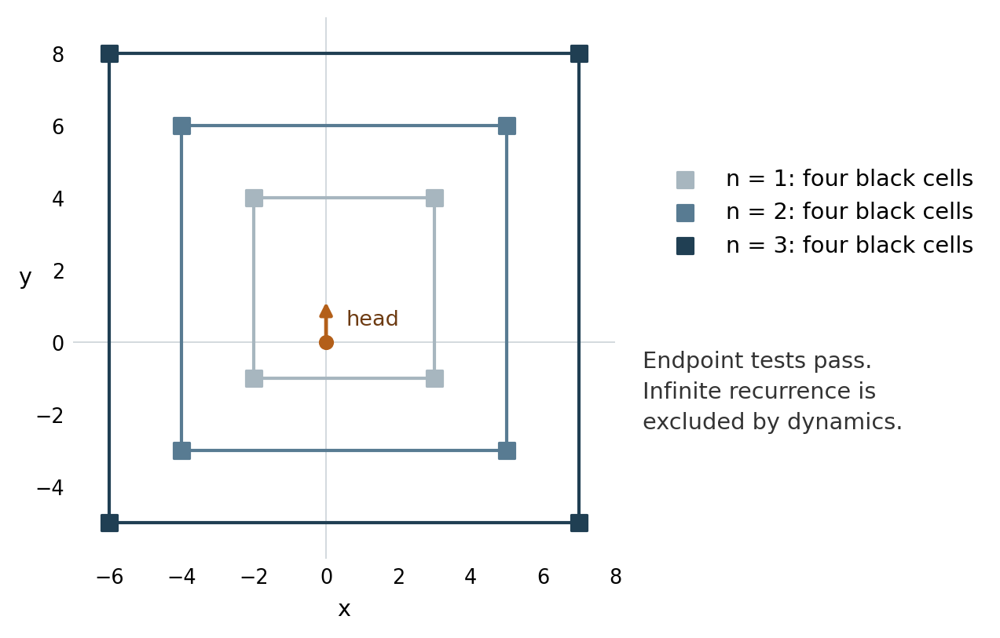

# Research status

The general finite-seed highway conjecture is not solved in this report. No finite-seed counterexample has been found. The main result of this continuation is a computer-assisted theorem: every finite-seed orbit visits states with at most four black cells only finitely often. Thus its current black mass is at least five at all sufficiently late times. The proof combines exact displacement and clock arguments with complete-field scattering certificates. The final certificate covers every integer parameter in an infinite family and every future highway period.

This report continues the research handoff dated 21 October 2026. It gives the new proofs, explains their limits, and identifies the unresolved steps. The accompanying archive contains the complete proof notes, exact checkers, recorded outputs, and the earlier continuation files needed to run them. The arguments here have been reviewed and checked by independent implementations. They have not been verified in a proof assistant or reviewed by an external mathematician. No publication priority is claimed for these deductions.

A public result missing from the handoff was also located. The revised two-black-cell manuscript dated 5 October 2026 supplies a Lean theorem for every start with at most two black cells, with no bound on their positions or separation. Its formal conclusion is eventual period-104 repetition of position increments, heading, and read color, with diagonal drift. Its stated scope stops before arbitrary three-cell and finite-pattern starts [1].

The source audit reports a successful clean build under Lean 4.30.0. The theorem depends on standard Lean axioms and 61 generated native-computation assertions. This continuation inspected the source and its trust report; it did not independently rebuild that artifact. The exact standard turn word is a separate external check in that project [2].

# The model and the main deductions

A complete state is $X=(B,p,h)$. The finite set $B\subset\mathbb Z^2$ contains every black cell. The ant is at $p=(x,y)$ with incoming heading $h$. A white read turns right. A black read turns left. The cell then flips, and the ant moves one lattice unit in its new heading. Write $X_t=(B_t,p_t,h_t)$ and $M_t=|B_t|$.

Headings are $N,E,S,W$, with unit vectors $d_N=(0,1)$, $d_E=(1,0)$, $d_S=(0,-1)$, and $d_W=(-1,0)$. The sector

$$
\sigma=(-1)^{x+y}
\begin{cases}1,&h\in\{N,S\},\\-1,&h\in\{E,W\}\end{cases}
$$

is invariant. Each step changes both the cell parity and the heading axis.

The statements below have different scopes. In particular, a lower bound on the eventual current mass does not prove eventual highway formation.

| Statement | Scope |
|:---|:---|
| $|B_s\triangle B_t|\ge 2\|m(X_t)-m(X_s)\|_\infty$ | Every finite interval; $m(X)=p-d_h/2$ |
| Each of four critical clocks increases within $2K+4$ updates | Every state with $M\le K$; the constant is sharp |
| Eventually $M_t\ge5$ | Every finite-seed orbit; computer-assisted proof |
| A finite white region cannot trap the active dual vertex forever | Explicit bound from its entry mass and width |
| $FV^nFV^mF$ is impossible for all $n,m\ge0$, where $F=CC$ | The pure $V$ rail sublanguage only |

# An exact displacement bound

For a horizontal row $r$, define

$$
S_r(B)=\sum_{(x,r)\in B}(-1)^x,
\qquad \kappa_r=\sigma(-1)^r.
$$

The following head correction takes values modulo four.

| Head position | $N$ | $E$ | $S$ | $W$ |
|:---|:---:|:---:|:---:|:---:|
| $p_y<r$ | $0$ | $0$ | $0$ | $0$ |
| $p_y=r$ | $0$ | $\kappa_r$ | $2$ | $-\kappa_r$ |
| $p_y>r$ | $2$ | $2$ | $2$ | $2$ |

Call it $G_r(p,h)$. Direct substitution in the eight heading and read-color cases proves that

$$
S_r(B_t)-G_r(p_t,h_t)\pmod4
$$

does not depend on time. Rotation gives the corresponding column invariant. These charges are explicit instances of the existing additive-charge framework in Jillhewar's paper [3]. Related signed-cut bounds also occur in Ke's research notes. The contribution here is the complete endpoint correction and its use in the recurrence argument.

There is a useful direct interpretation. A complete passage through a row reads two adjacent cells. If their colors agree, the passage returns to the same side and changes $S_r$ by zero. If the colors differ, the passage exits on the other side and changes $S_r$ by two modulo four. Thus, when the endpoint heads are off the row,

$$
S_r(B_t)-S_r(B_s)
\equiv 2\,\mathbf1\{p_s,p_t\text{ lie on opposite sides of row }r\}\pmod4.
$$

Every row strictly between the endpoint heads therefore needs at least two changed cells. The endpoint correction makes this count sharp. The midpoint of the incoming edge is

$$
m(X)=p-\tfrac12d_h.
$$

Summing the minimum required signed changes over rows, and then over columns, gives

$$
\boxed{|B_s\triangle B_t|\ge2\|m(X_t)-m(X_s)\|_\infty.}
$$

For unequal endpoint row coordinates, the row sum is exactly $|2(p_t^y-p_s^y)+d_{h_s}^y-d_{h_t}^y|$. For equal row coordinates it is the cyclic heading distance. The column formula is the same with $x$ in place of $y$. Each formula bounds the corresponding midpoint difference. A single update attains equality, so the coefficient and endpoint correction cannot be improved uniformly.

**Consequence for recurrence.** At any two times with $M_s,M_t\le K$, the midpoint distance is at most $K$. All such head cells lie in a fixed box of coordinate diameter at most $K+1$. Thus infinitely many low-mass states would include a subsequence with exactly the same head position and heading. Their black cells could still lie arbitrarily far away. The next argument addresses that remote memory.

# Four clocks and a sharp forcing bound

Put $z=x+y$, $u=x-y$, and $\chi(q)=(-1)^{q_x+q_y}$. Define

$$
e_z(N)=e_z(E)=1,\quad e_z(S)=e_z(W)=-1,
$$

$$
e_u(E)=e_u(S)=1,\quad e_u(W)=e_u(N)=-1,
\qquad a(1)=\tfrac12,\quad a(-1)=-\tfrac32.
$$

The four critical components of Ke's clock construction [4] are

$$
\Psi_{z,\pm}(X)=-\sigma\sum_{q\in B}\chi(q)3^{\pm z(q)}
                  +a(\pm e_z(h))3^{\pm z(p)},
$$

$$
\Psi_{u,\pm}(X)=\sigma\sum_{q\in B}\chi(q)3^{\pm u(q)}
                  +a(\pm e_u(h))3^{\pm u(p)}.
$$

The opposite field signs in these two formulas are essential. For $v=z$ or $u$, direct calculation gives

$$
\Delta\Psi_{v,+}=4\,3^{v(p)}\mathbf1\{e_v(h)=-1,\ e_v(h')=1\},
$$

$$
\Delta\Psi_{v,-}=4\,3^{-v(p)}\mathbf1\{e_v(h)=1,\ e_v(h')=-1\}.
$$

Exactly one component increases at each update. All four are nondecreasing. An individual component can be negative, and it need not diverge on an arbitrary escaping orbit.

**Sharp forcing theorem.** If the current mass is at most $K$, each of the four increment types occurs among the next $2K+4$ updates. The mass is allowed to rise during those updates.

To prove this, forbid the increment $e_z:-1\to+1$. The heading sequence can first use $N,E$ and then use $S,W$, with at most one switch between the two sets. Within each part, the path is a monotone diagonal staircase.

Every read cell in such a segment is distinct. The only possible difficulty is a return after the switch. If at least two northeast steps precede that switch, the second subsequent southwest move reaches the cell from two northeast steps earlier. Continuing in the southwest set would require the same turn there as before. The first read flipped that cell, so the required turn is impossible. Its actual turn is the forbidden increment. If fewer than two northeast steps precede the switch, the two staircase portions do not overlap.

Every left turn in an avoiding segment therefore consumes a distinct cell that was black at its start. Hence there are at most $K$ left turns. Each staircase has alternating right and left turns. The two alternating portions and the single switch together have at most three more right turns than left turns. The total avoiding length is at most $2K+3$.

The bound is attained. With head $(0,0),N$ and

$$
B_K=\{(j+1,j):0\le j<K\},
$$

the first $2K+3$ turns are $(RL)^KRRR$. The next update is the first increment of the specified clock. Rotation proves sharpness for each of the other types.

# Low-mass recurrence forces all four clocks to diverge

Fix a finite-seed orbit. Suppose $M_t\le K$ at infinitely many times. The displacement bound puts all heads at these times in a fixed finite box. Choose infinitely many of these times so that the following blocks of $2K+4$ updates are disjoint.

The forcing theorem gives an increment of every clock in each block. All reads in these fixed-length blocks lie in one fixed enlargement of the head box. The positive increments thus have a uniform positive lower bound. For example, if $|z|,|u|\le R$ at checkpoint heads, one can use

$$
\delta=4\,3^{-(R+2K+3)}.
$$

Each selected block increases every clock by at least $\delta$. Monotonicity between the blocks now proves

$$
\Psi_{z,+},\ \Psi_{z,-},\ \Psi_{u,+},\ \Psi_{u,-}\longrightarrow+\infty.
$$

This conclusion does not need positive initial clock values. It is stronger than a fixed lower bound on each clock.

**Eventual exclusion of mass at most three.** Suppose there were infinitely many times with $M_t\le3$. Put $b(q)=-\sigma\chi(q)$. The $z$ field sums have coefficient $b(q)$, while the $u$ field sums have coefficient $-b(q)$.

One of these two sign classes has at most one black cell. If at most one has $b=+1$, the positive contributions to the two $z$ field sums are at most $3^{z(q)}$ and $3^{-z(q)}$. At least one is at most one. The other cells contribute nonpositive terms. If at most one has $b=-1$, the same argument applies to the $u$ pair.

The head terms are bounded above because the checkpoint heads stay in a fixed box. Thus at every checkpoint of mass at most three,

$$
\min\{\Psi_{z,+},\Psi_{z,-},\Psi_{u,+},\Psi_{u,-}\}
\le1+\tfrac12\,3^R.
$$

This contradicts the divergence of all four components. Therefore

$$
\boxed{M_t\ge4\quad\text{for all sufficiently large }t.}
$$

This theorem concerns the current mass along every finite-seed orbit. It does not prove that every seed with three black cells reaches a highway. It also does not prove $M_t\to\infty$.

# Why endpoint inequalities alone do not exclude four cells

Four black cells can satisfy all the endpoint clock inequalities. With the head fixed at $(0,0),N$, consider

$$
B_n=\{-2n,2n+1\}\times\{-2n+1,2n+2\},\qquad n\ge1.
$$

Each occupied row and column has signed sum zero. All four one-sided clock field terms are positive, increase with $n$, and diverge. The convex hulls are nested. The family also passes increase of every centered radial clock. For example, with $f(v)=3^{|v|}$ and $d_n=4n+1$, its $z$ field term is

$$
f(2-d_n-c)+f(2+d_n-c)-2f(2-c),
$$

which increases with $d_n$ for every center $c$. The $u$ formula has center $-1$ in place of $2$.

{width=5.8in}

These are algebraically compatible endpoint states. The endpoint tests do not establish successive reachability. The dynamical proof below excludes infinite mass-four recurrence, including any proposed recurrence through these rectangles. This distinction shows why a counting step on the clocks alone is insufficient.

# Excluding infinite four-cell recurrence

Suppose mass four recurs infinitely often. Pass to a fixed-head subsequence and normalize its pose to $(0,0),N$. Two cells with checkerboard sign $\chi=-1$ must have $z\to-\infty$ and $z\to+\infty$. The other two, with $\chi=+1$, must have $u\to-\infty$ and $u\to+\infty$. All four cells therefore leave every fixed bounded region.

Coupling to the blank orbit shows that the first far collision must occur on its southwest highway. The incoming heading must be horizontal. Only ten first-read phases remain: $14,28,32,38,46,56,60,62,70,72$, in the phase convention at blank update 9977.

Signed row and column charges force exact axial partners for that collider $q$:

$$
B=\{q,\ (q_x,t),\ (r,q_y),\ d\}.
$$

The two axial gaps tend to infinity, and $z(d)\to+\infty$. Exact all-future scattering guards exclude nine of the ten phases. For those phases, every recovery and future read $v$ satisfies $z(v)\le z(q)+58$. Its intersections with the horizontal and vertical lines through $q$ have distances at most 31 and 34. These bounds miss all three other initial cells and the complete retained blank history once the checkpoint is sufficiently late.

Only phase 72 remains. It sends the ant back toward old material. The full proof of this first-collision reduction, including all field differences and tail guards, is in `chronology/mass4_first_collision.md`. In the convenient parameter used by the later certificate, its coordinate is

$$
q=(l,b)=(-33-2n,-14-2n),\qquad n\longrightarrow\infty.
$$

## The first collider is an exposed southwest corner

Write $a=(l,t)$ and $c=(r,b)$ for the two axial partners, and $d=(s,v)$ for the remaining cell. Put $H=t-b$ and $J=r-l$. Since $u(q)=-19$,

$$
u(a)=-19-H,\qquad u(c)=-19+J.
$$

The two quantities tend to opposite infinities. Thus $H,J$ have the same eventual sign and unbounded absolute values. They cannot both be negative: then both coordinates of $q,a,c$ tend to negative infinity. Since $z(d)\to+\infty$, at least one coordinate of $d$ is far positive. Its remote row or column would contain only $d$, contrary to its zero signed charge. Therefore $H,J\to+\infty$, $u(a)\to-\infty$, and $u(c)\to+\infty$.

Choose a fixed box containing the original finite seed, its head, and the normalized checkpoint head. Every row or column outside this box has zero signed charge at the selected checkpoints. The cell $d$ cannot be a third point on the remote row or column of $q$. Its $x$-coordinate must either equal $r$ or stay in the fixed box; its $y$-coordinate must either equal $t$ or stay in that box. In both cases,

$$
s-l\longrightarrow+\infty,\qquad v-b\longrightarrow+\infty.
$$

This does not yet assume a rectangle. The next two collisions force its remaining coordinates. All uses of a remote line's zero charge concern the original four-cell checkpoint, not an intermediate scattering state.

## The second collision fixes the upper-left corner

An exact all-parameter certificate proves the following parent trajectory. Start from $(0,0),N$ with only $q$ black. For every integer $n\ge200$, at time

$$
T_1(n)=208n+70733
$$

it reaches $(-15,26),E$ and follows a standard northwest highway forever. Every earlier read satisfies $-82\le u\le58$ and $z\le39$. The complete future has $u\le58$ and $z\le39$. Five more updates give a literal phase-zero thirteen-cell canonical core at $(-15,29),N$. The symmetric difference between the complete actual field and this placed core lies in $-82\le u\le58$ and is zero at every future read of the incoming highway.

For a sufficiently late hypothetical checkpoint, the three added cells $a,c,d$ miss this parent prefix, because $u(a)\to-\infty$, $u(c)\to+\infty$, and $z(d)\to+\infty$. Only $a$ can later interrupt its northwest highway. A collision with $a$ must occur; otherwise the actual trajectory already has a permanent standard future and cannot return to mass four infinitely often.

At this far northwest hit, $z(a)$ is bounded. Since $a_x=l\to-\infty$, its row $t\to+\infty$ is remote. Its only possible partner in the original checkpoint field is $d$, so $v=t$.

The nine ordinary scattering channels have the rotated all-future guard

$$
u(w)\le u(a)+58,
$$

and reach at most 34 cells along the horizontal axis through $a$. Their read traces miss the entire retained archive, whose $u$-coordinate is at least $-82$, and miss $c$, whose $u$-coordinate tends to positive infinity. They also miss $d$, which lies on that horizontal axis at distance $s-l\to\infty$. Complete-field coupling therefore turns every ordinary channel into a permanent escape, a contradiction.

The second hit must also be phase 72. Its exact fresh-cell ray is

$$
(-23,31)+k(-2,2),\qquad k\ge0.
$$

Intersecting with $a_x=l=-33-2n$ gives $k=n+5$ and

$$
a=(-33-2n,41+2n),\qquad d_y=41+2n.
$$

## The third collision forces the full rectangle

With only the now-fixed cells $q,a$ black, a second certified parent reaches $(40,-50),S$ at

$$
T_2(n)=416n+146040.
$$

It then follows a standard southeast highway forever. Its full prefix has $u\le98$ and $z\le71$, and its complete future has $z\le71$. Four more updates give a phase-zero thirteen-cell core at $(40,-52),S$. The full symmetric-difference archive lies in $u\le97$; the weaker bound $u\le98$ suffices here. It is zero at every future read of this incoming highway.

The remaining $c,d$ miss the parent prefix for late checkpoints. The highway cannot hit $d$, whose $z$-coordinate tends to positive infinity. It must hit $c$, since otherwise it is already permanent. At that southeast collision $z(c)$ is bounded. Since $c_y=b\to-\infty$, its column $r\to+\infty$ is remote. The original checkpoint column charge forces $s=r$.

The nine ordinary channels now have $u(w)\ge u(c)-58$. They miss the full archive, which has $u\le98$. Their vertical-axis reach from $c$ is at most 31, so they also miss $d$, whose vertical separation is $55+4n$. Again every ordinary channel gives permanent escape and is excluded.

The third hit must be phase 72. Its exact ray is

$$
(48,-54)+k(2,-2),\qquad k\ge0.
$$

Intersecting with $c_y=b=-14-2n$ gives $k=n-20$ and $c=(8+2n,-14-2n)$. Thus the entire checkpoint field is forced to be

$$
\boxed{B_n=\{-33-2n,8+2n\}\times\{-14-2n,41+2n\}.}
$$

Both later phase-zero origins have even checkerboard parity. The two axial partners have $\chi=+1$, so their eligible fresh phases are exactly the same ten phases used in the first-collision audit. This checks that the rotated ordinary-channel exclusions use the correct phase class.

## The forced rectangle has a permanent highway

For every integer $n\ge200$, the exact symbolic certificate proves that the forced rectangle, with head $(0,0),N$, reaches a permanent northwest standard highway by

$$
\boxed{T(n)=728n+200304.}
$$

At that time its pose is $(-2n-58,2n+98),N$. Every 104 updates then translate the pose by $(-2,2)$. The northeast input corner is never read, either before this time or in the infinite future. The standard word has 58 right turns and 46 left turns, so the mass increases by twelve per complete period.

The proof stores the full field as an XOR sum of affine points and finite diagonal segments. It checks every required read color in each fixed word. For repeated highway periods, it converts all old-point and old-segment intersections into exact intervals of period indices. Earlier writes of the current period give further intervals. Cancellation of all parity boundaries proves the color identities simultaneously for every $n\ge200$ and every period index. A separate unbounded-epoch check proves the infinite tail. Any unhandled parameter-dependent ordering or divisibility case rejects the witness.

This certificate verifies 21,030 distinct finite-word color requirements, 424 periodic read constraints, and 22,010 affine guards. The candidate word was found from finite runs; these exact symbolic checks supply the proof for all parameters. Independent literal simulations at $n=200,201,500$ replayed 1,256,840 updates, matched nine complete symbolic fields, and separately certified each infinite tail.

Along the hypothetical recurrence subsequence, $n\to\infty$. Choose one checkpoint late enough for every guard and for $n\ge200$. Its forced rectangle has the permanent future just proved. It cannot have infinitely many later mass-four checkpoints. This contradiction excludes mass-four recurrence. Together with the analytic exclusion of mass at most three,

$$
\boxed{\exists T_0<\infty\quad\forall t\ge T_0:\quad M_t\ge5.}
$$

This is a computer-assisted theorem for every finite initial seed. It does not prove capture from every seed with at most four black cells, and it does not prove that $M_t$ tends to infinity. The complete reduction and all certificate dependencies are in `chronology/eventual_mass_five.md`.

# A quantitative bound on the running maximum

The displacement bound also makes the growth of the running maximum explicit. Let $m=M_0$, and suppose $M_t\le K$ for $0\le t\le T$. All heads then lie in a rectangle containing at most

$$
A=(m+K+1)(m+K+2)
$$

lattice cells. Every field change occurs inside that rectangle. The complete field never repeats: an extreme corner of any nontrivial path segment is read exactly once, so at least one cell changes. This is the corner argument used in Etse's no-coloring-repeat result [5].

There are at most $\sum_{j=0}^K\binom Aj$ possible fields under the mass cap, with the unchanged exterior fixed. Consequently

$$
T+1\le\sum_{j=0}^K\binom{(m+K+1)(m+K+2)}j.
$$

For fixed $m$, this gives

$$
\max_{0\le t\le T}M_t
\ge(1-o(1))\frac{\log T}{\log\log T}.
$$

This is a running-maximum result. It allows returns to smaller mass and makes no claim about a pointwise rate.

# A local-limit reduction for further low-mass returns

The clock argument has a more general consequence. If one finite-seed orbit has infinitely many checkpoints with mass at most $K$, then at least four black cells eventually lie outside every fixed finite set. Otherwise, along a subsequence, at most three outside cells would leave one clock bounded above, by the same checkerboard argument used earlier. The cells inside the fixed set and the bounded head terms cannot change this conclusion.

Take a subsequence with a fixed head pose and with every fixed cell's color eventually constant. The limit field $B_*$ is finite and satisfies

$$
|B_*|\le K-4.
$$

For every fixed number of updates, sufficiently late checkpoint states reproduce the limit state's entire read, position, and heading sequence for that many updates. This follows because only finitely many initial colors affect a finite trajectory prefix.

For $K\le6$, the limit has at most two black cells. The inspected public two-black theorem therefore gives a translating period-104 future for that limit [1]. The original orbit must then contain arbitrarily long copies of one fixed highway tail. This application uses the public theorem, which was not rebuilt here; the main eventual-five theorem above does not depend on it.

The checkpoint threshold can depend on the requested prefix length. It is invalid to exchange “for every finite length, some sufficiently late checkpoint” with “one checkpoint works for every length.” Remote bits can interrupt a long apparent highway and cause a return to old material. For $K=4$ the local limit is blank, and the special three-collision analysis closes that case. For larger $K$, the limit can already have a nonblank seed, and the returning ant meets different debris. A general theorem controlling those later interactions is still needed. The full quantifier argument is in `chronology/low_mass_local_limit.md`.

# Finite white regions cannot trap the ant forever

Use the planar dual of the black-edge representation. Its vertices are the even plaquettes. A dual bond is present exactly when its corresponding ant cell is white. The active dual vertex lies to the left of the incoming ant edge. A local calculation gives the update rule: a white read crosses a present bond and deletes it; a black read inserts a missing bond and keeps the same active vertex [3].

Since the black set is finite, the white graph has a unique infinite component. Let $S_t$ contain all vertices in its finite components. During an episode in which the active vertex remains in finite white components, the entire set $S_t$ is constant. Deleting an internal bond only splits a finite component. Adding an internal bond only merges finite components or closes a cycle.

Let $K$ be the ordinary nearest-neighbor component of $S$ that contains the entry vertex. All pre-exit changes lie inside $K$. Its boundary remains black until an exit update inserts a bond to the infinite component. If the entry mass is $E$, and $N=|K|$, the square-lattice boundary inequality gives

$$
N\le E^2/16.
$$

Let $m_K$ be the number of internal bonds. Then $m_K\le2N$. There are at most $4N2^{m_K}$ possible complete states during the episode. A repeated state would give a bounded periodic orbit, which the strictly increasing integer clock excludes.

A sharper estimate uses the shorter side $r$ of the dual bounding rectangle of $K$. The boundary gives $r\le E/4$. Applying the integer clock in that direction bounds its possible range and yields

$$
\boxed{\tau\le m_K(3^{r-1}-1)+2(3^r-1)+1.}
$$

Here $\tau$ includes the exit update. This proves that every finite-seed orbit reaches the infinite white component infinitely often. It does not control repeated returns along that component's outer interface. That interface remains a separate global obstacle.

# The restricted five-block branch

The earlier work reduced the turn-language component $H$ to five before-marker words $C,V,U,Q,B$. In the north-heading frame, their lengths are $15,18,28,64,74$. The blocks $U,V$ advance along a rail; $C,Q,B$ can change direction. A finite-seed infinite $H$ tail would need infinitely many such changes. That has not been excluded.

Put $F=CC$. The continuation proves, for all $n,m\ge0$,

$$
FV^nFV^mF\quad\text{is physically infeasible.}
$$

In each parameter range, two consecutive visits to one cell would require the same turn even though the cell flipped. The proof gives the offending cell and both visit times as exact formulas. Thus a physical infinite stream over $\{V,CC\}$ has at most two $CC$ blocks. Its eventual $V$ tail needs infinitely many initially black cells and cannot come from finite support.

The restriction to pure $V$ rails matters. The mixed word $FV^4U^2FV^3F$, followed by the next marker, is feasible on a 28-cell finite seed. A larger claim that all turn macros have a uniform bound is also false on arbitrary backgrounds. An explicit infinite feasible spiral is $\prod_{i\ge0}U^{5\cdot2^i}CV$. Its first $k$ legs require $4+25(2^k-1)+2k$ initially black cells. It is therefore not a finite-seed counterexample.

One possible replacement is a geometric fuel bound: every feasible finite five-block path might stay within four cells of the bounding box of its distinct first-read black cells. Complete search through 13 macros found 1,536,076 feasible prefixes and no counterexample. The maximum excess was four. This remains a conjecture.

The continuation built an exact finite-field verifier for proposed local height potentials. It uses a finite strip language whose paths begin and end in the white state, so every counterexample is a complete finite field. All tested candidates failed. The largest port-dependent run stopped after nine rounds with 130,759 retained counterfields. This is neither a successful invariant nor a proof that all such invariants are impossible.

A stronger negative result applies to the last tested candidate. There are feasible paths $VU^{n+2}$ for every $n\ge0$ on $75+5n$ initially black cells. Its proposed potential rises from zero to one on the first $V$, for every member of the family. Thus no bounded amount of future-word conditioning repairs those particular weights. Different weights and nonlocal invariants remain unexcluded.

# Exact negative controls

Three tempting shortcuts failed on finite, fully specified states.

First, two adjacent all-white columns are not a permanent barrier. A 16-cell finite seed crosses columns 1 and 2 and restores both to white after 127 updates. The complete path, seed, and final field are recorded. An argument based only on such a cleared strip would be invalid.

Second, an internal finite-white episode can repeat the head position and heading before exiting. A two-by-two dual region with black boundary does this after four right turns and exits after six updates. The field is different on the repeated pose.

Third, the proposed exit estimate $\tau\le4|K|$ is false. A six-by-six dual square with 24 black boundary bonds and white interior exits after 148 updates, exceeding $4|K|=144$. The exponential clock bound above survives these controls.

# Verification and the remaining proof obligations

The displacement and clock conclusions have analytic proofs. The improvement from eventual mass at least four to eventual mass at least five also uses exact computer-assisted certificates. Finite simulations check implementations; symbolic parameter and infinite-ray checks establish the unbounded statements used in the proof.

| Audit | Recorded result |
|:---|:---|
| Signed-line and midpoint checks | 523,982 exact line checks over 6,000 complete-field intervals |
| Clock forcing | All local cases; exhaustive avoiding plans for $K=0$ through $16$; 40,400 first-event checks |
| Independent complex-coordinate implementation | 65,536 updates; 86,016 support-change intervals; 40,960 exact clock comparisons |
| Sharp forcing family | Independent check for $K=0$ through $100$ |
| Finite white episodes | 150,932 exhaustive small-region cases and 116 sampled complete episodes |
| Ordinary first-collision exclusion | Ten complete-field anchor replays and exact infinite-ray guards |
| Exceptional rectangle and parent trajectories | Every integer $n\ge200$; all prescribed reads and infinite standard tails |
| Independent rectangle audit | 1,256,840 literal updates; nine complete-field comparisons; three exact infinite-tail checks |
| Independent archive/core audit | Complete XOR archives vanish at every future incoming-highway read for all $n\ge200$ |
| Restricted fold theorem | Exact symbolic witnesses for all $n,m$, with finite implementation checks |

The archive preserves successful checks, failed conjectures, and capped searches under separate status labels. A finite simulation that reaches a certified tail is a proof for that supplied finite input. It becomes a proof for an unbounded family only when the parameter guards and tail exclusions have also been proved.

The full highway conjecture still requires a global argument. The current turn-language route has two gaps: exclusion of an infinite finite-seed $H$ tail, and exclusion of infinitely many adjacent forbidden ten-letter factors. A proof of the proposed fuel bound would address the first gap, but would leave the second. The clock route has a different gap: it constrains low-mass returns but does not establish eventual period-104 motion. The corridor route handles one and two corridors in the public two-cell proof; its authors describe a three-cell family outside that normal form [1].

The decisive requirement is a rule that controls all later returns to earlier altered regions. A proof must retain the full old field or give a valid guard that makes the omitted region unreachable. The work in this continuation does not supply that rule for arbitrary finite seeds.

# Sources and proof files

1. *Every Langton's ant start with at most two black cells reaches a translating period-104 highway*, revised manuscript, 5 October 2026. Public repository `imfinn/langton-two-black`, commit `95e896e3035e992e48ce9d28a5ded8568c86e835`. [Manuscript](https://github.com/imfinn/langton-two-black/blob/95e896e3035e992e48ce9d28a5ded8568c86e835/paper/TWO_BLACK_CELLS_REVISED.md).

2. Two-black artifact [trust account](https://github.com/imfinn/langton-two-black/blob/95e896e3035e992e48ce9d28a5ded8568c86e835/TRUST.md) and [audit report](https://github.com/imfinn/langton-two-black/blob/95e896e3035e992e48ce9d28a5ded8568c86e835/AUDIT.md). These are source reports, not a fresh build performed in this continuation.

3. Atharva Jillhewar, *Finite-Support Periodic Highways of Langton's Ant: Necessary Conditions, Transverse Exclusions, and Exact Search*, 17 August 2026. [Paper source](https://github.com/Atharva12456/langtons-ant-highway/blob/main/paper/main.tex). Additive-charge cocycle and medial graph representation.

4. Hao Ke, [clock proof](https://github.com/kehao95/langtons-ant-core/blob/main/clock_escape/PROOF.md) and [one-black proof](https://github.com/kehao95/langtons-ant-core/blob/main/one_black/PROOF.md). The earlier continuation also records the pinned canonical one-bit stability source and its reconstructed complete certificate.

5. Etse, MFCS 2026, LIPIcs volume 386, article 49, pages 49:1–49:17. [Publisher record](https://drops.dagstuhl.de/entities/document/10.4230/LIPIcs.MFCS.2026.49). Quantitative confinement and no-coloring-repeat context.

The main combined theorem is in `chronology/eventual_mass_five.md`. Its prerequisites and exact data are in `chronology/axial_separator_proof.md`, `chronology/low_mass_recurrence.md`, `chronology/mass4_first_collision.md`, `chronology/exceptional_stage_core_audit.md`, and `planar_structure/exceptional_rectangle_proof.md`. The separate white-region and language results are in `planar_structure/finite_white_episodes.md` and `fold_geometry/fold_geometry_status.md`. The archive root explains commands and dependencies. Third-party source prose is linked and hashed rather than reproduced in the archive.
